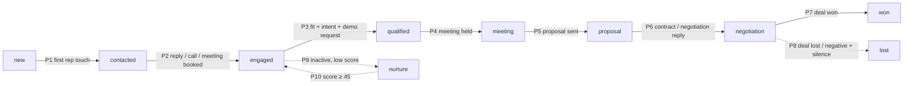
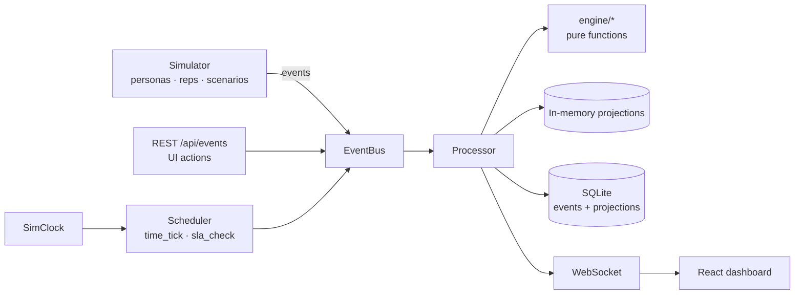

<div align="center">

# LeadPilot

**Autonomous lead-to-deal intelligence: every lead scored, staged, assigned and explained in real time.**


</div>

---

LeadPilot reads a live stream of lead and engagement events: form fills, page views, email opens and replies, calls,
meetings, proposals. **On every single event** it:

- re-scores the lead and detects buying intent
- moves the pipeline stage when there is evidence
- flags stalled deals
- predicts deal value and close probability
- assigns the lead to the best rep, or reassigns it if the rep is neglecting it
- recommends the next best action

…and it **explains every change**, so you always know *why* a lead is where it is.

A built-in simulator generates a realistic world of leads, buyer personas and sales reps, so the whole system runs
live out of the box with no external accounts.

## Table of contents

- [Quick start](#quick-start)
- [What goes in, what comes out](#what-goes-in-what-comes-out)
- [How scoring works](#how-scoring-works)
- [How leads move through the pipeline](#how-leads-move-through-the-pipeline)
- [Architecture](#architecture)
- [Dashboard tour (5-minute demo)](#dashboard-tour-5-minute-demo)
- [API](#api)
- [Configuration](#configuration)
- [Testing & performance](#testing--performance)
- [Using real data instead of the simulator](#using-real-data-instead-of-the-simulator)
- [Project structure](#project-structure)
- [Known simplifications](#known-simplifications)

---

## Quick start

**Requirements:** Python 3.12, Node.js 18+, and `make` (optional).

```bash
make install   # creates backend/.venv, installs Python + npm dependencies
make dev       # starts the API (port 8000) and the dashboard (port 5173)
```

Open **http://localhost:5173**. Sign in with the demo account (**demo@leadpilot.io** / **pilot123**) or create your
own account on the *Create account* page. Interactive API docs are at **http://localhost:8000/docs**.

On first start the backend generates 6 months of closed-deal history and simulates a 21-day warm-up (about 150 open
leads). This takes 10–20 seconds. After that the simulator runs live at 60× speed (1 simulated minute per real second).

<details>
<summary><b>Without make (Windows)</b></summary>

```bash
py -3.12 -m venv backend/.venv
backend/.venv/Scripts/pip install -r backend/requirements.txt
cd frontend && npm install && cd ..
python scripts/dev.py
```

On macOS / Linux use `python3.12 -m venv backend/.venv` and `backend/.venv/bin/pip`.
</details>

| Command | What it does |
|---|---|
| `make dev` | Backend (FastAPI + in-process simulator) and frontend (Vite) together |
| `make test` | 149 pytest tests: engine units, invariants I1–I8, scenarios, analytics, API |
| `make perf` | Sustained 50 events/s load test, prints p50 / p95 / p99 latency |
| `make build` | Production frontend build |

---

## What goes in, what comes out

```mermaid
flowchart LR
  subgraph IN[Inputs]
    E[Lead & engagement events<br/>forms · page views · emails · calls · meetings]
    R[Reference data<br/>companies · reps · sources]
    C[Rules & weights<br/>YAML config]
    U[User actions<br/>override · reassign · mark done]
  end
  subgraph OUT[Outputs]
    S[Score 0–100 + grade A–D<br/>with explanation]
    P[Pipeline stage<br/>with rule + evidence]
    O[Owner rep + reassignment]
    N[Next best action]
    F[Risk flags<br/>stalled · duplicate · bot]
    W[Win probability + deal value]
    A[Queue · analytics · live feed]
  end
  IN --> LP((LeadPilot<br/>engine)) --> OUT
```



**Inputs**

| Input | Examples |
|---|---|
| Lead events | `lead_created`, `page_view`, `email_opened`, `email_replied`, `demo_request`, `meeting_held`, `proposal_sent`, `deal_won` |
| Reference data | Companies (for enrichment), sales reps (regions, segments, capacity), lead sources |
| Rules & weights | `backend/config/*.yaml`: points, half-lives, stage rules, SLAs, assignment weights |
| User actions | Score/stage override, disqualify, reassign, mark action done, approve merges, simulator controls |

**Outputs (per lead)**

| Output | Description |
|---|---|
| **Score & grade** | 0–100, A Hot (≥ 80) · B Warm (≥ 60) · C Cool (≥ 40) · D Cold, with a factor-by-factor explanation |
| **Stage** | `new → contacted → engaged → qualified → meeting → proposal → negotiation → won`, plus `lost`, `nurture`, `disqualified` |
| **Owner** | Best-fit rep by region, segment, language, load and win rate, reassigned automatically on SLA breach |
| **Next best action** | e.g. *Call now and book a demo*, with priority and due time |
| **Flags** | Stalled (with reason), duplicate (auto-merged or sent for review), fake/bot (quarantined) |
| **Prediction** | Expected deal value, close probability and expected close date, each with its drivers |

**Outputs (system-wide):** a prioritized work queue per rep, funnel and response-time analytics, rep leaderboard,
source quality, a quality review queue, and a live event feed pushed over WebSocket.

---

## How scoring works

```
score = clamp( Fit[0..40] + Engagement[0..35] + Intent[0..25] − Penalties , 0, 100 )
```

| Part | Max | Measures | Examples |
|---|---|---|---|
| **Fit** | 40 | Is this our kind of customer? | Company size, industry ICP tier, seniority, served region, business email |
| **Engagement** | 35 | Are they paying attention? | Email open +1, click +3, download +5, reply +8, meeting +12 |
| **Intent** | 25 | Are they trying to buy? | Pricing page +6, demo request +15, contact sales +12, trial +12, proposal viewed +8 |
| **Penalties** | — | Warning signs | 14+ quiet days, unanswered follow-ups, bounce, unsubscribe, negative reply, bot risk |

Three rules keep the score fair:

1. **Signals fade.** Each event contributes `points × 0.5^(age / half_life)`. Yesterday's pricing visit counts more than
   last month's.
2. **Repeats count less.** The k-th repeat of the same signal within 7 days is multiplied by `repeat_decay^(k−1)`.
3. **Categories saturate.** Engagement and intent follow `cap × (1 − e^(−raw/k))`, so 100 email opens can't make a
   lead hot.

Intent also earns a **burst bonus** (≥ 3 high-intent signals in 72 h) and a **buying-committee bonus** (≥ 2 other
people from the same company active in 14 days).

**Every change is explained.** Each score change is the exact difference of two factor vectors, and the
contributions always add up exactly to the change. Example from the dashboard:

```
Score 30 → 43   +10.0 Penalty · Staleness cleared   +3.8 Engagement · Email click
Score 43 → 52    +7.1 Intent · Pricing-page visit
Score 58 → 62    +2.7 Intent · 3 high-intent signals within 72h (burst bonus)
Score 62 → 72   Filled a high-intent form and requested a demo
```

**Close probability** starts from a stage prior and is adjusted by score, intent level, the owner's win rate,
stall status, days over SLA and source quality. Each term is shown as a "why" factor. A logistic regression
model fitted on the simulated deal history is shown in Analytics for calibration.

---

## How leads move through the pipeline

A lead only moves when an event proves it should. Every move records the **rule ID, the reason and the evidence
event**.



| Rule | Move | Trigger |
|---|---|---|
| P1 | → contacted | First rep email or call |
| P2 | → engaged | Prospect replies, picks up a call, or a meeting is scheduled |
| P3 | → qualified | Fit ≥ 25 **and** Intent ≥ 12 **and** a demo / contact-sales request in the last 30 days |
| P4 | → meeting | A discovery or demo meeting is held |
| P5 | → proposal | Proposal sent |
| P6 | → negotiation | Contract sent, or a reply about discount / terms / legal after the proposal |
| P7 | → won | Deal won |
| P8 | → lost | Deal lost, or a "not interested" reply followed by 30 days of silence |
| P9 | → nurture | Early stage, score ≤ 30 and 30 days inactive |
| P10 | nurture → engaged | Score recovers to ≥ 45 |
| P11 | → disqualified | Rejected by a rep, or quarantined as fake |
| M1 | any | Manual override from the dashboard |

**Stall detection** runs alongside: S1 inactivity beyond the stage SLA, S2 missed follow-up, S3 engagement velocity
drop, S4 ghosting (unanswered follow-ups), S5 no next step after a meeting.

---

## Architecture



Each event goes through an 11-step pipeline, one event at a time and ordered per lead:

```
1 normalize → 2 identity / dedupe → 3 quality → 4 enrich → 5 append to log
→ 6 recompute score · intent · stage · stall · prediction → 7 assign / reassign
→ 8 next best action → 9 priority → 10 persist → 11 broadcast
```

**Design decisions**

- **Event sourcing.** The raw event log is the source of truth. `POST /api/replay` re-feeds it through the same code
  path and reproduces identical state.
- **Pure engine.** All business logic lives in `backend/app/engine/` as pure functions of
  `(profile, events, now, context, config)`, with no database, I/O or clock reads. This makes it easy to test.
- **Config, not code.** Every weight, threshold, half-life and SLA lives in `backend/config/*.yaml`.
- **Deterministic time.** All time comes from `SimClock`, and the simulator is a seeded discrete-event simulation, so
  the same seed gives the same world at any speed.
- **Order-independent stages.** The stage is a deterministic fold over the lead's events sorted by timestamp, so
  late or out-of-order events produce the same result.
- **Inactivity is an event.** Hourly `time_tick` events decay scores and check stalls, and are explained like any
  other change.

**Tech stack:** FastAPI · SQLAlchemy Core · SQLite · scikit-learn · React 18 · TypeScript · Vite 5 · Tailwind CSS v4 ·
TanStack Query · Recharts.

---

## Dashboard tour (5-minute demo)

0. **Sign in.** The app opens with a short brand animation (click or press any key to skip). On *Sign in* the form is on
   the right; on *Create account* the panels swap sides. The brand panel shows live numbers from the running engine.
   Toggle light / dark / system from the top bar or the account menu. Press **Ctrl K** (or **/**) to search leads.
   Almost every number, chip, bar and name in the dashboard is a link: grades, stages, sources, signals, owners, KPI
   tiles, chart bars and counters open the matching filtered view (usually the **Leads** page, whose filters live in
   the URL so any view can be bookmarked or shared).
1. **My Queue.** Leads ordered by priority for the selected rep. Each row shows a grade pill with a score sparkline,
   intent chips, the stage, stall flag, SLA countdown, the next best action (**Mark done**) and the top reasons.
2. **Simulator → Reviver → Launch**, then set speed to 600×. Priya starts cold in *nurture* (score ~30). She visits
   pricing 3× and requests a demo. Her score climbs to ~75–80 and she moves *nurture → engaged (P10) → qualified (P3)*.
   She is assigned to the right rep, with the NBA **Call now and book a demo**. Click any point on the score chart to
   see that event's explanation.
3. **Ghoster.** Tom's proposal goes unanswered. Within about 8 simulated days he is **stalled (S1 + S4)**, his close
   probability drops and the NBA switches to *multi-thread*.
4. **Duplicate.** A second form from `rahul.k+ads@acme.io` **auto-merges** into the existing lead. See
   *Quality → Merge history*.
5. **Bot burst.** 20 junk leads are quarantined and never assigned. The source is flagged on *Quality → Source quality*.
6. **Neglected hot lead.** A grade-A lead given to a neglectful rep is **reassigned automatically** at the 60-minute
   SLA.
7. **Analytics.** Funnel and conversion, time in stage, first-response times and SLA attainment per rep, score
   distribution, grade vs. actual win rate, model calibration and a rep leaderboard.
8. **Replay event log** rebuilds every projection from the raw log and confirms identical results.

---

## API

Full interactive docs at **`/docs`** (Swagger UI). Main endpoints:

| Method | Endpoint | Purpose |
|---|---|---|
| `POST` | `/api/events` | Ingest one event or a list of events |
| `GET` | `/api/leads` · `/api/leads/{id}` | Lead list and full lead detail |
| `GET` | `/api/leads/{id}/timeline` · `/score-history` | Unified timeline and explained score history |
| `POST` | `/api/leads/{id}/override-stage` · `/disqualify` · `/assign` | Manual actions |
| `GET` | `/api/queue/{rep_id}` | A rep's prioritized work queue |
| `POST` | `/api/actions/{id}/done` | Complete a recommended action |
| `GET` | `/api/pipeline` · `/api/reps` | Pipeline board and reps |
| `GET` | `/api/analytics/funnel` · `/response-times` · `/rep-performance` · `/score-calibration` · `/source-quality` | Analytics |
| `GET/POST` | `/api/quality/review-queue` · `/review/{id}` · `/quarantine` · `/merges` | Duplicate and fake-lead review |
| `POST` | `/api/sim/start` · `/pause` · `/step` · `/speed` · `/reset` · `/scenario/{name}` | Simulator controls |
| `POST` | `/api/replay` | Rebuild all state from the event log |
| `GET` | `/api/health` · `/api/feed` | Health check and recent event feed |
| `WS` | `/ws` | Live stream of every change |

Example event:

```json
POST /api/events
{
  "type": "page_view",
  "ts": "2026-10-08T10:42:00Z",
  "lead_ref": { "email": "priya@acme.io" },
  "payload": { "page_category": "pricing" }
}
```

---

## Configuration

| File | Controls |
|---|---|
| `scoring.yaml` | Fit / engagement / intent points, half-lives, saturation, penalties, grade thresholds, reply classifier |
| `pipeline.yaml` | Stages, rules P1–P11, stall SLAs and weights, deal-value and close-probability model |
| `assignment.yaml` | Regions, segments, language, load weights, reassignment SLAs |
| `quality.yaml` | Duplicate matching thresholds, fake-lead signals |
| `nba.yaml` | Next-best-action rules N1–N15 and priority weights |
| `simulator.yaml` | Lead volume, sources, personas, rep profiles, warm-up length, seed |

| Environment variable | Default | Purpose |
|---|---|---|
| `LEADPILOT_DB` | `backend/var/leadpilot.db` | SQLite file path |
| `LEADPILOT_PERSIST` | `1` | Set to `0` to run fully in memory |
| `LEADPILOT_WARMUP_DAYS` | `21` | Length of the simulated warm-up |
| `USE_LLM` | `false` | Optional LLM reply-classifier hook (core logic never depends on it) |

---

## Testing & performance

```bash
make test   # 149 tests
make perf   # load test
```

The test suite covers every engine module, every stage rule (P1–P11), stall rule (S1–S5) and action rule
(N1–N15), the end-to-end scenarios, analytics, the API, and eight system invariants:

| | Invariant |
|---|---|
| I1 | Every processed event produces a factor snapshot and a score-change record |
| I2 | Explanation contributions sum exactly to the score change (including clamping) |
| I3 | Same seed + same events → identical scores, stages and assignments |
| I4 | Replaying the event log reproduces the same state as live processing |
| I5 | Shuffling the arrival order of a lead's events gives the same final state |
| I6 | Re-ingesting the same event ID changes nothing (idempotency) |
| I7 | Every stage change has a rule ID and at least one evidence event (or is manual) |
| I8 | With no new events, time alone lowers an engaged lead's score, and the change cites decay |

**Performance** (laptop, SQLite commit per event, sustained 50 events/s): **p50 3.1 ms · p95 8.7 ms**. The target is
< 50 ms. A full hourly tick re-scoring ~160 open leads takes ~0.3 s. If the database sits in a cloud-synced folder,
set `LEADPILOT_DB` to a local path to avoid fsync spikes.

---

## Using real data instead of the simulator

The engine doesn't care where events come from, so real sources can post to `POST /api/events` in the format shown
above. Typical adapters:

| Real source | Events | Connection |
|---|---|---|
| Website forms (HubSpot, Webflow, Typeform) | `lead_created`, `demo_request`, `contact_sales` | Form webhook → `/api/events` |
| Web analytics (Segment, PostHog, GA4) | `page_view` | Tracking webhook |
| Email tools (Gmail, Outlook, Apollo) | `email_sent`, `email_opened`, `email_clicked`, `email_replied` | Webhooks / API polling |
| CRM (HubSpot, Salesforce, Pipedrive) | `call_logged`, `meeting_held`, `proposal_sent`, `deal_won` | Webhooks / sync job |
| Calendar (Calendly) | `meeting_scheduled`, `meeting_held` | Webhook |

To run on real data in production, you would also need to:

- [ ] Switch the clock to wall-clock time and turn off the simulator
- [ ] Load state from the database on startup (today the server starts from a fresh simulated world)
- [ ] Replace the mock enrichment provider with a real one (Clearbit, Apollo, …)
- [ ] Load your real sales team instead of `backend/data/reps.json`
- [ ] Add authentication (an API key or webhook signatures, plus a dashboard login)
- [ ] Move to Postgres for larger teams

---

## Project structure

```
backend/
  config/        scoring · pipeline · assignment · quality · nba · simulator (YAML)
  data/          seed companies, reps, sources, domain lists, IP geo
  app/
    engine/      pure functions: normalize · identity · quality · enrich · profile · scoring · intent
                 explain · metrics · pipeline · stall · prediction · assignment · nba · priority
    simulator/   personas · generator · history · scenarios
    analytics/   funnel · response_time · source_quality · rep_performance · calibration
    api/         leads · pipeline · reps · analytics · sim · websocket routes
    processor.py store.py persistence.py runtime.py scheduler.py clock.py bus.py main.py
  scripts/       perf.py (load test) · gen_seed_data.py
  tests/         one file per engine module + invariants, scenarios, analytics, API
frontend/
  src/pages/     Login (sign in + create account) · Queue · Leads · LeadDetail · Pipeline · LiveFeed · Analytics · Quality ·
                 Simulator · NotFound (404)
  src/components Shell (sidebar, top bar, search, toasts) · Splash · Logo · icons · ui · charts
  src/lib        api client · live WebSocket · formatting · theme (light/dark) · auth (browser-local accounts) ·
                 links (drill-down URLs)
  public/        favicon.svg (adapts to dark mode) · favicon.ico · PNG + Apple touch icons · web manifest
scripts/dev.py   runs backend + frontend together
Makefile
```

---

## Known simplifications

- A lead and its opportunity are 1:1. A lead counts as a "deal" from *qualified* onward.
- Enrichment, MX validation and IP geolocation are mocked from seed data in `backend/data`.
- Reply classification is keyword-based by default. An LLM classifier is a stub behind `USE_LLM`.
- A single-process asyncio event bus. The `EventBus` interface allows Kafka or Redis Streams partitioned by `lead_id`.
- Weights are expert-set. The logistic model and the grade-vs-conversion chart show how to calibrate them.
- Plus-tags are stripped from all email domains, so `rahul.k+ads@acme.io` matches `rahul.k@acme.io`. Dots are
  stripped for Gmail only.
- Accounts are stored in the browser (localStorage, salted SHA-256 password hashes). The API has no authentication, so
  this gates the dashboard UI only and nothing is enforced server-side. "Forgot password" resets the password of an
  account in the same browser. Replace the functions in `frontend/src/lib/auth.tsx` when the API adds auth.
- The in-memory store is the working set and SQLite is the durable copy. The server starts from a fresh seeded world.
