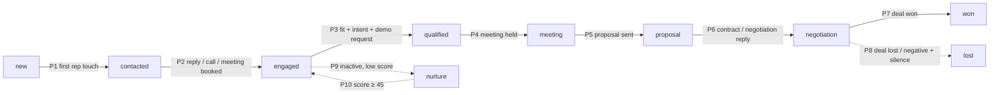
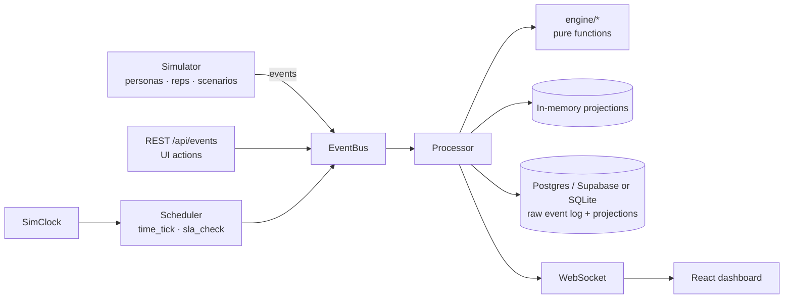

<div align="center">

# LeadPilot

Lead scoring, pipeline staging and rep assignment for B2B sales, with the reason for every change.


</div>

---

LeadPilot processes a stream of lead and engagement events (form fills, page views, email opens and replies, calls,
meetings, proposals). For each event it:

- re-scores the lead and records which signals changed the score
- moves the lead to a new pipeline stage when the event is evidence for it
- flags deals that have stalled
- predicts deal value and close probability
- assigns the lead to a rep, and reassigns it if the first-touch SLA is missed
- recommends the next action for the rep

Each of these decisions is stored with the rule and the events behind it, and the dashboard shows them on the lead page.

A built-in simulator generates leads, buyer personas and sales reps, so the system runs without any external accounts.

## Table of contents

- [Quick start](#quick-start)
- [What goes in, what comes out](#what-goes-in-what-comes-out)
- [How scoring works](#how-scoring-works)
- [How leads move through the pipeline](#how-leads-move-through-the-pipeline)
- [Architecture](#architecture)
- [Dashboard tour (5-minute demo)](#dashboard-tour-5-minute-demo)
- [API](#api)
- [Configuration](#configuration)
- [Database (Supabase / Postgres)](#database-supabase--postgres)
- [Sign-in, roles and API keys](#sign-in-roles-and-api-keys)
- [Connectors: forms, CRM, email, website, CSV](#connectors-forms-crm-email-website-csv)
- [Accounts and deals](#accounts-and-deals)
- [Quotes](#quotes)
- [Settings console](#settings-console)
- [Notifications](#notifications)
- [Call intelligence](#call-intelligence)
- [Testing & performance](#testing--performance)
- [Using real data instead of the simulator](#using-real-data-instead-of-the-simulator)
- [Project structure](#project-structure)
- [Known simplifications](#known-simplifications)

---

## Quick start

**Requirements:** Python 3.10 or newer and Node.js 18 or newer. `make` is optional.

From the project folder, on Windows, macOS or Linux:

```bash
python scripts/dev.py      # Windows; on macOS / Linux use python3
```

The first run creates `backend/.venv` and installs the Python and npm dependencies (about a minute). Later runs
reinstall only when `requirements.txt` or `package-lock.json` changed, so pulling new code just works. When the
terminal prints `ready`, open **http://localhost:5173**. API docs are at **http://localhost:8000/docs**. Ctrl-C stops
both servers. Without Supabase configured there is no login: you are a local admin. With it, see
[Sign-in, roles and API keys](#sign-in-roles-and-api-keys).

On first start the backend generates 6 months of closed-deal history and simulates a 21-day warm-up (about 150 open
leads). This takes 10–20 seconds. After that the simulator runs live at 60× speed (1 simulated minute per real second).

<details>
<summary><b>If it does not start</b></summary>

- *Python 3.10 or newer is required* / *Node.js 18 or newer is required*: install from python.org / nodejs.org, open a
  new terminal, and run the command again.
- *port 8000 (or 5173) is already in use*: an earlier run is still going. Close that terminal or stop the process.
- *setup step failed*: the lines above it show the pip or npm error. Delete `backend/.venv` (or
  `frontend/node_modules`) and run again to start the install from scratch.
- The dashboard shows *The LeadPilot API is not reachable*: the backend is not running or crashed; look for `[api]`
  errors in the terminal.
</details>

| Command | What it does |
|---|---|
| `make dev` | Same as `python scripts/dev.py`: backend (FastAPI + simulator) and frontend (Vite) together |
| `make install` | Install or refresh dependencies only (`python scripts/dev.py --setup`) |
| `make test` | 220 pytest tests: engine units, invariants I1–I8, scenarios, analytics, API, live mode, auth, connectors, deals |
| `make test-pg` | Postgres / Supabase tests, run in a throwaway `leadpilot_test` schema |
| `make e2e` | Playwright browser tests: every page, lead drill-down, ingestion, mobile width, login and roles, connectors |
| `make perf` | Sustained 50 events/s load test, prints p50 / p95 / p99 latency |
| `make build` | Production frontend build |

---

## What goes in, what comes out

```mermaid
flowchart LR
  subgraph IN[Inputs]
    E[Lead & engagement events<br/>forms · page views · emails · calls · meetings]
    R[Reference data<br/>companies · reps · sources]
    C[Rules & weights<br/>YAML config]
    U[User actions<br/>override · reassign · mark done]
  end
  subgraph OUT[Outputs]
    S[Score 0–100 + grade A–D<br/>with explanation]
    P[Pipeline stage<br/>with rule + evidence]
    O[Owner rep + reassignment]
    N[Next best action]
    F[Risk flags<br/>stalled · duplicate · bot]
    W[Win probability + deal value]
    A[Queue · analytics · live feed]
  end
  IN --> LP((LeadPilot<br/>engine)) --> OUT
```



**Inputs**

| Input | Examples |
|---|---|
| Lead events | `lead_created`, `page_view`, `email_opened`, `email_replied`, `demo_request`, `meeting_held`, `proposal_sent`, `deal_won` |
| Reference data | Companies (for enrichment), sales reps (regions, segments, capacity), lead sources |
| Rules & weights | `backend/config/*.yaml`: points, half-lives, stage rules, SLAs, assignment weights |
| User actions | Score/stage override, disqualify, reassign, mark action done, approve merges, simulator controls |

**Outputs (per lead)**

| Output | Description |
|---|---|
| **Score & grade** | 0–100, A Hot (≥ 80) · B Warm (≥ 60) · C Cool (≥ 40) · D Cold, with a factor-by-factor explanation |
| **Stage** | `new → contacted → engaged → qualified → meeting → proposal → negotiation → won`, plus `lost`, `nurture`, `disqualified` |
| **Owner** | Best-fit rep by region, segment, language, load and win rate, reassigned automatically on SLA breach |
| **Next best action** | e.g. *Call now and book a demo*, with priority and due time |
| **Flags** | Stalled (with reason), duplicate (auto-merged or sent for review), fake/bot (quarantined) |
| **Prediction** | Expected deal value, close probability and expected close date, each with its drivers |

**Outputs (system-wide):** a prioritized work queue per rep, funnel and response-time analytics, rep leaderboard,
source quality, a quality review queue, and a live event feed pushed over WebSocket.

---

## How scoring works

```
score = clamp( Fit[0..40] + Engagement[0..35] + Intent[0..25] − Penalties , 0, 100 )
```

| Part | Max | Measures | Examples |
|---|---|---|---|
| **Fit** | 40 | Is this our kind of customer? | Company size, industry ICP tier, seniority, served region, business email |
| **Engagement** | 35 | Are they paying attention? | Email open +1, click +3, download +5, reply +8, meeting +12 |
| **Intent** | 25 | Are they trying to buy? | Pricing page +6, demo request +15, contact sales +12, trial +12, proposal viewed +8 |
| **Penalties** | — | Warning signs | 14+ quiet days, unanswered follow-ups, bounce, unsubscribe, negative reply, bot risk |

Three rules keep the score fair:

1. **Signals fade.** Each event contributes `points × 0.5^(age / half_life)`. Yesterday's pricing visit counts more than
   last month's.
2. **Repeats count less.** The k-th repeat of the same signal within 7 days is multiplied by `repeat_decay^(k−1)`.
3. **Categories saturate.** Engagement and intent follow `cap × (1 − e^(−raw/k))`, so 100 email opens can't make a
   lead hot.

Intent also earns a **burst bonus** (≥ 3 high-intent signals in 72 h) and a **buying-committee bonus** (≥ 2 other
people from the same company active in 14 days).

**Every change is explained.** Each score change is the exact difference of two factor vectors, and the
contributions always add up exactly to the change. Example from the dashboard:

```
Score 30 → 43   +10.0 Penalty · Staleness cleared   +3.8 Engagement · Email click
Score 43 → 52    +7.1 Intent · Pricing-page visit
Score 58 → 62    +2.7 Intent · 3 high-intent signals within 72h (burst bonus)
Score 62 → 72   Filled a high-intent form and requested a demo
```

**Close probability** starts from a stage prior and is adjusted by score, intent level, the owner's win rate,
stall status, days over SLA and source quality. Each term is shown as a "why" factor. A logistic regression
model fitted on the simulated deal history is shown in Analytics for calibration.

---

## How leads move through the pipeline

A lead only moves when an event proves it should. Every move records the **rule ID, the reason and the evidence
event**.



| Rule | Move | Trigger |
|---|---|---|
| P1 | → contacted | First rep email or call |
| P2 | → engaged | Prospect replies, picks up a call, or a meeting is scheduled |
| P3 | → qualified | Fit ≥ 25 **and** Intent ≥ 12 **and** a demo / contact-sales request in the last 30 days |
| P4 | → meeting | A discovery or demo meeting is held |
| P5 | → proposal | Proposal sent |
| P6 | → negotiation | Contract sent, or a reply about discount / terms / legal after the proposal |
| P7 | → won | Deal won |
| P8 | → lost | Deal lost, or a "not interested" reply followed by 30 days of silence |
| P9 | → nurture | Early stage, score ≤ 30 and 30 days inactive |
| P10 | nurture → engaged | Score recovers to ≥ 45 |
| P11 | → disqualified | Rejected by a rep, or quarantined as fake |
| M1 | any | Manual override from the dashboard |

**Stall detection** runs alongside: S1 inactivity beyond the stage SLA, S2 missed follow-up, S3 engagement velocity
drop, S4 ghosting (unanswered follow-ups), S5 no next step after a meeting.

---

## Architecture



Each event goes through an 11-step pipeline, one event at a time and ordered per lead:

```
1 normalize → 2 identity / dedupe → 3 quality → 4 enrich → 5 append to log
→ 6 recompute score · intent · stage · stall · prediction → 7 assign / reassign
→ 8 next best action → 9 priority → 10 persist → 11 broadcast
```

**Design decisions**

- **Event sourcing.** The raw event log (`raw_events`, every envelope exactly as ingested) is the source of truth.
  `POST /api/replay` and every live-mode startup re-feed it through the same code path and reproduce identical state.
- **Pure engine.** All business logic lives in `backend/app/engine/` as pure functions of
  `(profile, events, now, context, config)`, with no database, I/O or clock reads. This makes it easy to test.
- **Config, not code.** Every weight, threshold, half-life and SLA lives in `backend/config/*.yaml`.
- **Deterministic time.** All time comes from `SimClock`, and the simulator is a seeded discrete-event simulation, so
  the same seed gives the same world at any speed.
- **Order-independent stages.** The stage is a deterministic fold over the lead's events sorted by timestamp, so
  late or out-of-order events produce the same result.
- **Inactivity is an event.** Hourly `time_tick` events decay scores and check stalls, and are explained like any
  other change.

**Tech stack:** FastAPI · SQLAlchemy Core · Postgres (Supabase) / SQLite · scikit-learn · React 18 · TypeScript · Vite 5 · Tailwind CSS v4 ·
TanStack Query · Recharts.

---

## Dashboard tour (5-minute demo)

0. **Sign in.** The app opens with a short brand animation (click or press any key to skip). Without Supabase configured
   the sign-in page is skipped. On *Sign in* the form is on the right; on *Create account* the panels swap sides. The
   brand panel shows whether the engine is running.
   Toggle light / dark / system from the top bar or the account menu. Press **Ctrl K** (or **/**) to search leads.
   Almost every number, chip, bar and name in the dashboard is a link: grades, stages, sources, signals, owners, KPI
   tiles, chart bars and counters open the matching filtered view (usually the **Leads** page, whose filters live in
   the URL so any view can be bookmarked or shared).
1. **My Queue.** Leads ordered by priority for the selected rep. Each row shows a grade pill with a score sparkline,
   intent chips, the stage, stall flag, SLA countdown, the next best action (**Mark done**) and the top reasons.
2. **Simulator → Reviver → Launch**, then set speed to 600×. Priya starts cold in *nurture* (score ~30). She visits
   pricing 3× and requests a demo. Her score climbs to ~75–80 and she moves *nurture → engaged (P10) → qualified (P3)*.
   She is assigned to the right rep, with the NBA **Call now and book a demo**. Click any point on the score chart to
   see that event's explanation.
3. **Ghoster.** Tom's proposal goes unanswered. Within about 8 simulated days he is **stalled (S1 + S4)**, his close
   probability drops and the NBA switches to *multi-thread*.
4. **Duplicate.** A second form from `rahul.k+ads@acme.io` **auto-merges** into the existing lead. See
   *Quality → Merge history*.
5. **Bot burst.** 20 junk leads are quarantined and never assigned. The source is flagged on *Quality → Source quality*.
6. **Neglected hot lead.** A grade-A lead given to a neglectful rep is **reassigned automatically** at the 60-minute
   SLA.
7. **Analytics.** Funnel and conversion, time in stage, first-response times and SLA attainment per rep, score
   distribution, grade vs. actual win rate, model calibration and a rep leaderboard.
8. **Pipeline → Deals.** One card per deal, however many people from the company take part. Open a deal for its
   stage history (each move names its rule, O0–O8), the buying committee and an edit form (amount, expected close,
   stage, won / lost with a reason). **Accounts** groups everyone at a company domain and shows who is missing from
   the buying committee.
9. **Settings** (admins). Lower grade A from 80 to 70 in *Scoring*, **Check changes** to see the change pass on real
   events, **What if?** to see which leads would move up, then **Save and activate**: every event is re-run and more
   leads are now grade A. **Roll back to this** on
   version 1 brings the YAML rules back as a new version.
10. **Notifications.** The bell shows new leads, replies, reassignments and won deals as the simulator runs;
    **All notifications and settings** shows your reps' notifications too, the channels and the rules.
11. **Calls.** On any lead page, **Log a call** with a note like "Customer: what does pricing look like?": it is
    summarised (by Gemini when `GEMINI_API_KEY` is set) and adds a buying-intent signal to the score.
12. **Replay event log** rebuilds every projection from the raw log and confirms identical results.

---

## API

Full interactive docs at **`/docs`** (Swagger UI). Main endpoints:

| Method | Endpoint | Purpose |
|---|---|---|
| `POST` | `/api/events` | Ingest one event or a list of events |
| `GET` | `/api/leads` · `/api/leads/{id}` | Lead list and full lead detail |
| `GET` | `/api/leads/{id}/timeline` · `/score-history` | Unified timeline and explained score history |
| `POST` | `/api/leads/{id}/override-stage` · `/disqualify` · `/assign` | Manual actions |
| `GET` | `/api/queue/{rep_id}` | A rep's prioritized work queue |
| `POST` | `/api/actions/{id}/done` | Complete a recommended action |
| `GET` | `/api/pipeline` · `/api/reps` | Pipeline board and reps |
| `GET` | `/api/analytics/funnel` · `/response-times` · `/rep-performance` · `/score-calibration` · `/source-quality` | Analytics |
| `GET/POST` | `/api/quality/review-queue` · `/review/{id}` · `/quarantine` · `/merges` | Duplicate and fake-lead review |
| `POST` | `/api/sim/start` · `/pause` · `/step` · `/speed` · `/reset` · `/scenario/{name}` | Simulator controls |
| `POST` | `/api/replay` | Rebuild all state from the event log |
| `GET` | `/api/health` · `/api/feed` | Health check and recent event feed |
| `GET` | `/api/auth/config` · `/api/me` | Login configuration (public) and the signed-in user's role and scope |
| `GET/PATCH` | `/api/admin/users` · `/api/admin/users/{id}` | People: roles, rep links, manager teams (admin) |
| `GET/POST/DELETE` | `/api/admin/api-keys` | Create, list and revoke ingestion keys (admin) |
| `GET/POST/PATCH/DELETE` | `/api/connectors` · `/{id}/rotate` · `/{id}/reveal` · `/{id}/deliveries` | Connectors and their delivery log (admin) |
| `POST` | `/api/hooks/{id}` | Inbound webhook, form, CRM record or email (authenticated by the connector's secret) |
| `GET` · `POST` | `/api/t.js` · `/api/track/{site key}` | Website tracker script and its page views / form captures |
| `POST` | `/api/import/preview` · `/api/import/commit` | CSV import (manager) |
| `GET` | `/api/accounts` · `/api/accounts/{id}` | Companies with their people, buying committee and deals |
| `GET/POST/PATCH` | `/api/opportunities` · `/api/opportunities/{id}` | Deal board, deal detail, create a deal, edit or close one |
| `GET` | `/api/quotes/catalog` · `/api/quotes` · `/api/quotes/{id}` | The catalog and quote rules · quotes on your deals (`status=needs_approval` for the approval queue) · one quote |
| `POST` · `PATCH` | `/api/opportunities/{id}/quotes` · `/api/quotes/{id}` | Draft a quote on a deal (`supersedes` for a new version) · change a draft |
| `POST` | `/api/quotes/{id}/approve` · `/send` · `/void` · `/accept` · `/decline` | Approve a discount (manager) · send (`email: true` to email it) · withdraw · record the buyer's answer |
| `GET` · `POST` | `/api/public/quotes/{token}` · `/accept` · `/decline` | The buyer's view of a quote, and their answer (no sign-in: the token is the key) |
| `GET` | `/api/config` · `/api/config/versions` · `/api/config/versions/{id}` | Rules in force, version history, one version with its changes (manager) |
| `POST` | `/api/config/check` | Validate edited rules and dry-run them on real events; returns problems or the list of changes (admin) |
| `POST` | `/api/config/versions` · `/{id}/activate` · `/{id}/restore` | Save a version (optionally activate it), activate a draft, roll back (admin) |
| `POST` · `GET` | `/api/config/whatif` · `/api/config/whatif/{id}` | Start a what-if run for edited rules or a saved version (admin); list runs and poll one for its result (manager) |
| `GET` | `/api/notifications` | Your notifications, newest first (`mine`, `unread`, `rule`, `before`, `limit`), with the unread count |
| `POST` | `/api/notifications/read` | Mark `{ids}` or `{all: true}` read |
| `GET/PUT` | `/api/notifications/settings` | Channel status, the rules (managers), and your own email / SMS settings and phone |
| `POST` | `/api/notifications/test` | Send a test on one channel to yourself, or to the Slack channel (admin) |
| `GET/POST` | `/api/leads/{id}/calls` | A lead's calls (summary, outcome, transcript) · log a call by hand |
| `GET` | `/api/calls` · `/api/calls/{id}` · `/api/calls/{id}/recording` · `/api/calls/status` | Recent calls (manager), one call, a recording link, whether Gemini and recording storage are set up |
| `POST` | `/api/calls/{id}/link` · `/api/calls/{id}/retry` | Attach a call to a lead, or retry a failed one (manager) |
| `WS` | `/ws` | Live stream of every change |

Example event:

```json
POST /api/events
X-API-Key: lp_…            (or a signed-in admin / manager session)
{
  "type": "page_view",
  "ts": "2026-10-08T10:42:00Z",
  "lead_ref": { "email": "priya@acme.io" },
  "payload": { "page_category": "pricing" }
}
```

---

## Configuration

| File | Controls |
|---|---|
| `scoring.yaml` | Fit / engagement / intent points, half-lives, saturation, penalties, grade thresholds, reply classifier |
| `pipeline.yaml` | Stages, rules P1–P11, stall SLAs and weights, deal-value and close-probability model |
| `assignment.yaml` | Regions, segments, language, load weights, reassignment SLAs |
| `quality.yaml` | Duplicate matching thresholds, fake-lead signals |
| `nba.yaml` | Next-best-action rules N1–N15 and priority weights |
| `quotes.yaml` | Quote catalog, discount approval limit, validity, default terms, seller name |
| `simulator.yaml` | Lead volume, sources, personas, rep profiles, warm-up length, seed |

The first six files are the defaults. Admins change them from the dashboard without a restart: see
[Settings console](#settings-console). `simulator.yaml` is only editable on disk.

Settings can also go in `backend/.env` (copy `backend/.env.example`; it is git-ignored). Real environment variables win.

| Environment variable | Default | Purpose |
|---|---|---|
| `LEADPILOT_DB` | `backend/var/leadpilot.db` | SQLite file path |
| `LEADPILOT_MODE` | `demo` | `demo`: seeded simulator on a simulated clock. `live`: wall-clock time, simulator off, state rebuilt from the event log on start |
| `LEADPILOT_DB_URL` | — | Postgres URL (Supabase session pooler). Empty means SQLite at `LEADPILOT_DB` |
| `LEADPILOT_DB_SCHEMA` | `public` | Postgres schema for LeadPilot's tables |
| `LEADPILOT_ALLOW_MODE_SWITCH` | `0` | Override the guard that stops demo mode from wiping live data |
| `LEADPILOT_AUTH` | `auto` | `auto` requires logins whenever Supabase is configured; `on` / `off` to force |
| `SUPABASE_URL` | derived | Supabase project URL; worked out from a Supabase `LEADPILOT_DB_URL` |
| `SUPABASE_ANON_KEY` | — | Anon / publishable key for the login screen |
| `LEADPILOT_ADMIN_EMAILS` | — | Comma-separated emails that are always admins |
| `LEADPILOT_PERSIST` | `1` | Set to `0` to run fully in memory |
| `LEADPILOT_WARMUP_DAYS` | `21` | Length of the simulated warm-up |
| `LEADPILOT_SIM_SPEED` | `60` | Demo clock speed at start (1, 10, 60, 600). Use 1 for an always-on hosted demo |
| `USE_LLM` | `false` | Optional LLM reply-classifier hook (core logic never depends on it) |
| `RESEND_API_KEY` · `LEADPILOT_EMAIL_FROM` | — | Email notifications through Resend (sender on a verified domain) |
| `SLACK_WEBHOOK_URL` | — | Slack notifications (one incoming webhook for the team channel) |
| `TWILIO_ACCOUNT_SID` · `TWILIO_AUTH_TOKEN` · `TWILIO_FROM_NUMBER` | — | SMS notifications through Twilio |
| `LEADPILOT_PUBLIC_URL` | — | Dashboard address, so emails, Slack posts and texts link to the lead or deal, and emailed quotes link to the buyer's page |
| `GEMINI_API_KEY` · `GEMINI_MODEL` | — · `gemini-2.5-flash` | Call summaries and outcomes by Gemini (otherwise phone-system summary or rules) |
| `RETELL_API_KEY` | — | Verifies Retell's signed call webhooks |
| `SUPABASE_SERVICE_ROLE_KEY` · `LEADPILOT_RECORDINGS_BUCKET` | — · `call-recordings` | Private copies of call recordings in Supabase Storage (server only) |
| `LEADPILOT_NOTIFY_IN_DEMO` | `0` | Deliver email / Slack / SMS in demo mode too (off: simulated leads only notify in the app) |

---

## Database (Supabase / Postgres)

LeadPilot runs on local SQLite with no setup, and on Postgres (built and tested on Supabase) in production.

1. In Supabase: **Project Settings → Database → Connection string → Session pooler** (port 5432).
2. Copy `backend/.env.example` to `backend/.env` and set `LEADPILOT_DB_URL` (a plain `postgresql://` URL is fine).
3. Start the server. Pending migrations in `supabase/migrations/` are applied automatically (recorded in
   `leadpilot_migrations`, guarded by an advisory lock). The files are idempotent, so `supabase db push` works too.

How it is stored:

- **`raw_events` is the source of truth.** Every accepted event, exactly as ingested. Every other table is a
  projection that LeadPilot can rebuild from it, and a live-mode restart does exactly that.
- **Writes never block processing.** The engine works in memory; a single writer thread commits each step's rows in
  order, merging whatever is queued into one statement per table. Raw events and their projections commit in the
  same transaction, so the database is always consistent with its log. Failed writes are retried, never dropped,
  and `GET /api/health` reports `pending_batches` and `last_error`.
- **Restarts are cheap when the rules are unchanged.** The `meta` table records the config fingerprint that produced
  the stored projections. If the YAML rules are the same, a restart rebuilds memory only; if they changed, it
  rewrites the projections from the raw log.
- **Row level security is on for every table** with no policies, so Supabase's public `anon` / `authenticated` API
  keys can read nothing. The backend connects as the database owner.
- **Demo and live data are kept apart.** Demo mode wipes its tables on every start, so the server refuses to start
  demo mode on a database that holds live data (and vice versa). Use `LEADPILOT_DB_SCHEMA=demo` for a demo
  alongside real data.

Measured against a Supabase project (ap-south-1, ~56 ms round trip): step latency p95 12 ms with writes in the
background; a full 21-day demo world (4,161 events) uploads in ~26 s while the dashboard is already usable; a
live restart of the same world takes ~12 s, all of it engine replay.

---

## Sign-in, roles and API keys

When Supabase is configured, every endpoint except `/api/health` and `/api/auth/config` needs a login or an API key.
People sign in with Supabase Auth (email + password); LeadPilot verifies the session token against the project's
published signing keys and keeps its own role for each person.

| Role | Sees | Can also |
|---|---|---|
| **admin** | Everything | Approve people, set roles and teams, create and revoke API keys, replay the log |
| **manager** | Leads owned by their team (or every rep) plus unassigned leads; analytics and quality | Reassign within their team, override stages, run the simulator (demo) |
| **rep** | Only their own leads: queue, pipeline, lead pages, live feed | Mark actions done, disqualify their own leads |
| **pending** | Nothing: a "waiting for access" page | |

- **Getting the first admin in:** put your email in `LEADPILOT_ADMIN_EMAILS`, sign up on the login page, confirm the
  email, sign in. Everyone else signs up and waits as *pending* until an admin gives them a role on **Access**.
- **Scope is enforced on the server.** Lists are filtered, and a lead outside your scope answers 404, so its
  existence is not revealed. The WebSocket feed is filtered per connection the same way.
- **API keys** (`lp_…`) are for machines: they can only call `POST /api/events`. Send one as `X-API-Key` or
  `Authorization: Bearer`. The key is shown once; LeadPilot stores only its SHA-256 hash, records when it was last
  used, and tags every event it sends (`ingested_via`) in the raw log.
- **Setup in Supabase:** Authentication → URL Configuration → set **Site URL** to where the dashboard runs (e.g.
  `http://localhost:5173`) so confirmation and password-reset links come back to LeadPilot.

---

## Connectors: forms, CRM, email, website, CSV

Admins add connectors on the **Connectors** page. Each one has its own endpoint and secret, a lead source, and a
delivery log showing every request it received, what it became and why anything was refused.

| Connector | What it takes | How it authenticates |
|---|---|---|
| **Webhook** | LeadPilot events from your own systems (one, a list, or `{"events": [...]}`) | Signature (required) |
| **Website form** | Any form post, JSON or form-encoded: Webflow, Typeform, WordPress, Zapier… Each submission becomes a lead; "demo", "trial" or "sales" in the form name adds the buying signal | `?token=` in the URL, or a signature |
| **CRM** | Contact records from HubSpot, Pipedrive, Salesforce workflows (nested `properties`, multi-value fields understood) | Signature (required) |
| **Inbound email** | Postmark, SendGrid Inbound Parse or Mailgun routes. Replies become `email_replied` with quoted history and signatures removed; bounces become `email_bounced`; out-of-office replies are marked and never count as engagement | `?token=` in the URL, or a signature |
| **Website tracker** | Page views and form submissions from a script on your site | Public site key, optional allowed-sites list |

**Signing** (webhook and CRM, optional for the others), in the style of Stripe:

```
X-LeadPilot-Timestamp: 1760086800                      (unix seconds, within 5 minutes of the server)
X-LeadPilot-Signature: v1=<hex HMAC-SHA256 of "{timestamp}.{raw body}" keyed with the connector secret>
```

A wrong signature or an old timestamp gets 401, and the exact same signed request sent twice gets 409. During a
secret rotation a sender may send several `v1=` values separated by commas. The Connectors page shows a ready-made
Node example.

**Retries are safe.** Every record gets a stable event id (from the form or CRM record id, the email Message-ID,
or a hash of the content), so a re-sent webhook is recorded as a duplicate instead of creating a second lead.

**Website tracker.** Paste the snippet the page gives you before `</body>`:

```html
<script async src="https://your-leadpilot/api/t.js" data-key="lpk_…"></script>
```

It records page views (categorized as pricing, enterprise, case study, comparison…; add your own rules per
connector) under a random visitor id kept in `localStorage`, with no cookies. When the visitor fills in a form with an
email address, the earlier anonymous visits are attached to that lead with their original times, so a lead who read
the pricing page twice before signing up arrives already warm. Password and card fields are never read, Do Not
Track / Global Privacy Control turn page views off, and known bots are ignored. Call
`window.leadpilot.identify({email, name}, "Newsletter")` from your own code for forms the script can't see.

**CSV import** (managers, **Import** page). Upload a spreadsheet or a CRM export of up to 5,000 rows. Columns are
matched by name ("Email Address", "Company Name", "Lead Source", "Create Date"…) and each can be changed or ignored
before importing. Rows without an email or phone, and repeats of the same person, are skipped and listed. A past
"created" date is loaded as history at that date (no live SLA alarms for old leads), and importing the same file
twice adds nothing the second time.

---

## Accounts and deals

People at the same company (the same web domain) form one **account**. A **deal** (opportunity) belongs to the
account, so several contacts can work on one deal, and one company can have several deals over time.

- **How a deal opens.** On the first buying signal from any contact at the account (demo request, sales enquiry,
  BANT qualification, meeting) when no deal is open: rule **O1**. A rep can also create one from a lead page (**O0**).
  After a win, the next signal opens an **expansion** deal.
- **How it moves.** Meeting held (**O4**), proposal sent (**O5**), contract sent or a positive reply after a proposal
  (**O6**), won (**O7**) or lost (**O8**). A rep can move it by hand (**OM**). Every move stores its rule, the events
  behind it and who made it, and the deal page lists them.
- **Which deal an event belongs to.** An event that names a deal (`payload.opportunity_id`) goes to that deal;
  anything else goes to the newest open deal at the account. A closed deal only changes when someone edits it.
- **Value and chance.** The deal's amount when one is set (by a rep or a contract), otherwise the predicted ACV.
  The chance to win uses the best contact's score and intent, the stage, the owner's record and the **buying
  committee**: each extra role involved (decision maker, manager, user, from job seniority) raises it.
- **Stalls.** A deal with no activity past its stage time limit is flagged (**S1**), like a lead.
- **Replays.** Deals are rebuilt from the event log, so a replay gives identical deals and event order does not matter.
- **Who sees what.** You see an account or deal when you can see at least one of its contacts. Contacts owned by other
  reps show their name and role only.

Rules and labels are in `opportunities` in `backend/config/pipeline.yaml`; deals are stored in the `opportunities`
table (migration `supabase/migrations/20261014000000_opportunities.sql`).

---

## Quotes

A rep builds a **quote** on a deal page (**Quotes → New quote**): lines from the catalog or typed in (quantity, unit
price, line discount, billed per year or once), a discount on the whole quote, a contact it is for and a date it is
valid until (30 days by default). The total shown is the first-year value: yearly items plus one-time items.

- **Approval.** A quote discounted by more than 15% off list (`approval.max_discount_pct`) needs a manager's
  approval before it can be sent. Managers get a notification; editing the quote after approval asks again.
- **Sending.** **Mark as sent** records a `proposal_sent` event for the quote: the deal moves to proposal (O5) and its
  amount becomes the quote's total. With email set up (Resend, `LEADPILOT_PUBLIC_URL`, and live mode), **Send by
  email** also emails the contact a link to it. A sent quote can no longer be edited: **New version** makes a copy
  that replaces it.
- **The buyer's link.** Each quote has its own link (`/q/<token>`, no sign-in; the long random token is the key). The
  buyer reads the quote, prints it or saves it as a PDF, and **accepts** (typing their name) or **declines** it.
  Opening it counts as a `proposal_viewed` (at most once every 6 hours) and the owner is told the first time.
  Accepting wins the deal at the quote's total (`deal_won`, O7); declining tells the owner and managers and leaves
  the deal open. Drafts and withdrawn quotes are not shown on the link. Reps can also record an answer they got by
  phone or email (**Buyer accepted / declined**).
- **Replays.** Every step is an event on the quote's contact (`quote_created`, `quote_revised`, `quote_approved`,
  `proposal_sent`, `proposal_viewed`, `deal_won`, `quote_declined`, `quote_voided`, each naming its deal and quote),
  and quotes are rebuilt with their deal. Lines keep their own prices, so changing the catalog never changes an
  existing quote. A sent quote past its date shows as expired and can no longer be accepted.

The catalog, the approval limit, the default terms and the seller name are in `backend/config/quotes.yaml` (also
editable in the Settings console). Quotes are stored in the `quotes` table (migration
`supabase/migrations/20261018000000_quotes.sql`).

---

## Notifications

The **bell** in the top bar and the **Notifications** page (`/notifications`, also in the account menu) show what
needs attention, as it happens. The rules are in `backend/config/notifications.yaml`:

| Rule | When | Who | Channels (default) |
|---|---|---|---|
| Hot lead | a grade-A lead is assigned or reassigned to a rep | the new owner | in app, email, SMS, Slack · urgent |
| New lead | any other new owner | the new owner | in app |
| Reply | the prospect replied | the owner | in app, email |
| Meeting or demo | the prospect booked a meeting, asked for a demo or for sales | the owner | in app, email |
| Reassigned | a first-touch or follow-up deadline was missed (R1, R2) | the old owner and managers | in app, Slack |
| Escalated | too many reassignments: the lead went to the manager queue (R3) | managers | in app, email, Slack · urgent |
| Stalled | a lead stalled with risk ≥ 50 | the owner | in app |
| Deal won / lost | a deal closed | the owner and managers | in app (+ Slack when won) |
| Quote approval | a quote's discount is above the limit | managers | in app, email |
| Quote approved / opened | a manager approved the discount · the buyer opened the quote for the first time | the owner | in app |
| Quote declined | the buyer declined a quote | the owner and managers | in app, email |
| Review needed | a suspicious lead waits for a quality review | managers | in app |
| Source flagged | a lead source looks like it sends junk | managers | in app, Slack |

- **Who sees what.** Reps see their own. "Managers" means managers whose team includes the lead's owner, plus admins.
  Managers and admins can also switch to **My reps' too** to see what their reps were sent. Read / unread is per
  person. Urgent ones also pop up as a toast.
- **Channels.** In-app always works. Email (Resend), Slack (incoming webhook) and SMS (Twilio) each do nothing until
  their keys are in `backend/.env` (see [Configuration](#configuration)). Admins see each channel's state on the
  Notifications page and can **Send test** to themselves. Each person chooses email and SMS for themselves under
  **Your settings** (SMS needs a mobile number). Every delivery is recorded as sent, failed (with the reason) or
  skipped, and admins see that on each notification.
- **Never twice.** Notifications come only from live processing. Replays, restarts, settings activations and the demo
  warm-up process events with broadcasting off, so they never notify anyone again, and the notification tables are
  kept through replays. A demo reset clears them.
- **Demo mode** notifies in the app only, so simulated leads never email or text real people
  (`LEADPILOT_NOTIFY_IN_DEMO=1` overrides that).

Stored in `notifications`, `notification_deliveries` and `notification_reads`, with `phone` and `notify` on
`profiles` (migration `supabase/migrations/20261016000000_notifications.sql`).

---

## Call intelligence

Calls come from the phone system (a **Phone calls** connector: Retell, or LeadPilot's generic call format for any
other system) or are logged by a rep on the lead page (**Log a call**: notes or a pasted transcript, optionally the
outcome). Each call is matched to its lead by the number dialled (or calling in), or by `lead_id` / `lead_email` in
the call's metadata.

- **Analysis, once.** Gemini reads the transcript and returns a fixed shape: a 2–4 sentence summary, the outcome
  (connected / voicemail / no answer), the result (meeting booked, interested, call back, not interested, …),
  sentiment, buying intent, the next step, buying signals, objections and competitors mentioned. The answer is
  checked and clipped before use. Without `GEMINI_API_KEY`, the phone system's own summary and simple rules
  (hang-up reason, keywords) are used, and the lead page says so.
- **Saved as events.** The analysis is written into the call's `call_logged` event (and a `meeting_scheduled` event
  when a meeting was agreed). Replays, restarts and settings activations read the events and never call Gemini
  again, so they stay exact. A connected call with buying intent adds the **call with buying intent** intent
  signal (`positive_call_intent` in `scoring.yaml`), and the call moves the lead like any connected call.
- **Recordings.** With `SUPABASE_SERVICE_ROLE_KEY`, each recording is copied into the private bucket
  `call-recordings` (created on first use) and played through a link that expires after an hour. Otherwise the
  phone system's own link is used.
- **Retell set-up.** Create a **Phone calls** connector, paste its URL as the webhook in Retell, put your Retell API
  key in `RETELL_API_KEY` (Retell signs webhooks with it) and restart. Calls are taken from `call_ended` when Gemini
  is set up, otherwise from `call_analyzed` (after Retell's own summary); the connector can force either.
- **Screens.** The lead page's **Calls** card (summary, outcome, signals, next step, recording, transcript) and
  **Calls** (`/calls`, managers): every call, with **Needs a lead** for calls from unknown numbers (link them to a
  lead to analyse them) and **Failed**. The owner gets a "Call with …" notification for each analysed phone-system call.

Calls are stored in the `calls` table (migration `supabase/migrations/20261017000000_calls.sql`), kept through
replays and cleared by a demo reset.

---

## Settings console

**System → Settings** (`/settings`) shows the rules behind every score, stage, assignment and next action, and lets
admins change them. Managers can look but not change anything.

- **Versions.** The YAML files in `backend/config` stay the defaults. A **settings version** stores only the settings
  that differ from them, so new defaults added in code reach every version. Version 1 ("Starting rules from the YAML
  files") is created on first start. Exactly one version is **active**; the others are **drafts** (saved, never used)
  or **retired** (used before).
- **Editing.** Each section (Scoring, Pipeline and deals, Assignment, Quality and duplicates, Next best actions, Quotes) is
  edited as YAML. **Show the documented defaults** shows the YAML file with its comments.
- **Check changes.** Validates the edit (valid YAML, same shape as the defaults, numbers stay numbers, the config
  loads) and **dry-runs** it on a built-in sample journey plus the first 400 real events in a scratch engine. It shows
  either a list of plain-English problems or a before / after table of every setting that would change.
- **What if?** Re-runs the **whole event log** twice in scratch engines, under the rules in force and under the
  edited rules (or any saved draft or older version, from the version history), as of the same moment, and shows
  exactly what would differ: how many leads change grade (up / down), stage, owner, next action or quality status,
  which deals would open, disappear or sit in another stage, the grade and stage mix and the pipeline before and
  after, and the leads and deals involved (with links). It runs in the background, so the dashboard keeps working;
  nothing is saved or switched. The result is exactly what **Save and activate** would produce.
- **Save as draft** or **Save and activate.** Activating swaps the rules everywhere and **re-runs the whole event
  log** under them, so every score, stage, assignment and deal reflects the new rules. Requests wait while it runs.
  If the replay fails, the previous version is put back.
- **Roll back.** **Roll back to this** on an older version saves its rules as a **new** version and activates it, so
  the history is never rewritten.
- **Traceability.** Every processed event and every score change records the version that produced it
  (`config_version`). Selecting a point on a lead's score chart shows "scored under rules vN".

Versions are stored in the `config_versions` table, which survives demo resets (migration
`supabase/migrations/20261015000000_config_versions.sql`).

---

## Testing & performance

```bash
make test   # 254 tests (5 Postgres tests skip unless enabled)
make test-pg # Postgres tests against LEADPILOT_DB_URL, in a throwaway schema
make e2e    # Playwright dashboard tests (starts its own API + dashboard on ports 8010 / 5180)
make perf   # load test
```

The test suite covers every engine module, every stage rule (P1–P11), stall rule (S1–S5) and action rule
(N1–N15), the end-to-end scenarios, analytics, the API, and eight system invariants:

| | Invariant |
|---|---|
| I1 | Every processed event produces a factor snapshot and a score-change record |
| I2 | Explanation contributions sum exactly to the score change (including clamping) |
| I3 | Same seed + same events → identical scores, stages and assignments |
| I4 | Replaying the event log reproduces the same state as live processing |
| I5 | Shuffling the arrival order of a lead's events gives the same final state |
| I6 | Re-ingesting the same event ID changes nothing (idempotency) |
| I7 | Every stage change has a rule ID and at least one evidence event (or is manual) |
| I8 | With no new events, time alone lowers an engaged lead's score, and the change cites decay |

**Performance** (laptop, SQLite commit per event, sustained 50 events/s): **p50 3.1 ms · p95 8.7 ms**. The target is
< 50 ms. A full hourly tick re-scoring ~160 open leads takes ~0.3 s. If the database sits in a cloud-synced folder,
set `LEADPILOT_DB` to a local path to avoid fsync spikes.

---

## Using real data instead of the simulator

The engine doesn't care where events come from. Forms, CRMs, inbound email, your website and spreadsheets plug in
through [Connectors](#connectors-forms-crm-email-website-csv) with no code; anything else can post to
`POST /api/events` in the format shown above. Typical sources:

| Real source | Events | Connection |
|---|---|---|
| Website forms (HubSpot, Webflow, Typeform) | `lead_created`, `demo_request`, `contact_sales` | Form webhook → `/api/events` |
| Web analytics (Segment, PostHog, GA4) | `page_view` | Tracking webhook |
| Email tools (Gmail, Outlook, Apollo) | `email_sent`, `email_opened`, `email_clicked`, `email_replied` | Webhooks / API polling |
| CRM (HubSpot, Salesforce, Pipedrive) | `call_logged`, `meeting_held`, `proposal_sent`, `deal_won` | Webhooks / sync job |
| Calendar (Calendly) | `meeting_scheduled`, `meeting_held` | Webhook |

To run on real data in production, you would also need to:

- [x] Switch the clock to wall-clock time and turn off the simulator (`LEADPILOT_MODE=live`)
- [x] Load state from the database on startup (live mode replays the durable `raw_events` log)
- [ ] Replace the mock enrichment provider with a real one (Clearbit, Apollo, …)
- [ ] Load your real sales team instead of `backend/data/reps.json`
- [x] Add authentication: dashboard login with roles, and API keys for ingestion (see [Sign-in](#sign-in-roles-and-api-keys))
- [x] Move to Postgres (Supabase): set `LEADPILOT_DB_URL`, see [Database](#database-supabase--postgres)
- [x] Connect real sources: signed webhooks, forms, CRM records, inbound email, a website tracker and CSV import

---

## Project structure

```
backend/
  config/        scoring · pipeline · assignment · quality · nba · quotes · simulator · notifications (YAML)
  data/          seed companies, reps, sources, domain lists, IP geo
  app/
    engine/      pure functions: normalize · identity · quality · enrich · profile · scoring · intent
                 explain · metrics · pipeline · stall · prediction · assignment · nba · priority · opportunity · quotes
    simulator/   personas · generator · history · scenarios
    analytics/   funnel · response_time · source_quality · rep_performance · calibration
    connectors/  field mapping · signing · email parsing · CSV import · store · tracker.js
    api/         leads · pipeline · reps · analytics · sim · auth · connectors · deals · quotes · config · websocket routes
    processor.py store.py persistence.py runtime.py scheduler.py clock.py bus.py main.py
    config_versions.py  settings versions: validation, diff, dry run
    whatif.py    what-if runs: scratch replays under two rule sets, compared
    notifications.py  notification rules, inbox, read state, email / Slack / SMS delivery
    calls/       Gemini analysis · Retell / generic call parsing · recordings in Supabase Storage · call center
  scripts/       perf.py (load test) · gen_seed_data.py
  tests/         one file per engine module + invariants, scenarios, analytics, API
frontend/
  src/pages/     Login (sign in + create account) · Queue · Leads · LeadDetail · Pipeline (deals / leads) · Accounts ·
                 Account · Deal · LiveFeed · Analytics · Quality · Simulator · Access · Connectors · Import · Settings · Notifications · Calls ·
                 PublicQuote (the buyer's quote link) · NotFound
  src/components Shell (sidebar, top bar, search, toasts) · Splash · Logo · icons · ui · charts · deals · whatif · notices · calls · quotes
  src/lib        api client · live WebSocket · formatting · theme (light/dark) · auth (Supabase sign-in) ·
                 links (drill-down URLs)
  public/        favicon.svg (adapts to dark mode) · favicon.ico · PNG + Apple touch icons · web manifest
scripts/dev.py   runs backend + frontend together
Makefile
```

---

## Known simplifications

- Accounts are keyed by company domain (from the email, or the website for free-mail addresses). A free-mail lead with
  no website is its own account. Buying roles come from job-title seniority only.
- Enrichment, MX validation and IP geolocation are mocked from seed data in `backend/data`.
- Reply classification is keyword-based by default. An LLM classifier is a stub behind `USE_LLM`.
- A single-process asyncio event bus. The `EventBus` interface allows Kafka or Redis Streams partitioned by `lead_id`.
- Weights are expert-set. The logistic model and the grade-vs-conversion chart show how to calibrate them.
- Plus-tags are stripped from all email domains, so `rahul.k+ads@acme.io` matches `rahul.k@acme.io`. Dots are
  stripped for Gmail only.
- The in-memory store is the working set and the database is the durable copy. Demo mode starts from a fresh seeded world;
  live mode rebuilds from the stored event log.
